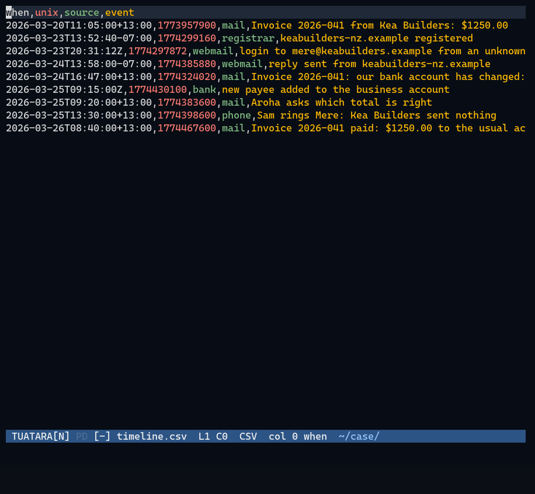

# csvdt

Read the manual:
[tuatara-editor.github.io/tuatara-csvdt](https://tuatara-editor.github.io/tuatara-csvdt/).

[csvdt](https://github.com/YardQuit/csvdt) run over a CSV buffer, a
selection or banked lines, the result in a buffer of its own, `*csvdt output*`.
csvdt converts the timestamps and durations of CSV records; this package hands
it the buffer, in the background, and never changes the buffer it came from. One
of the Tuatara project's packages, not part of the editor.

`C-c v` in a CSV buffer shows its commands. The manual says which lines a run
covers, how the arguments are typed and what the settings do. A run over a
selection or banked lines gives csvdt the whole buffer and `--lines` naming the
selected lines; csvdt reads the buffer as it reads any file, so it alone says
where a record begins, which lines are comments and which record is the header.
What csvdt writes is held in memory, so a run may write eight times its input,
or 64 MB, whichever is more, and never more than a quarter of the editor's free
memory; past that it is ended and the echo area says so.

<picture>
  <source media="(prefers-color-scheme: light)" srcset="media/csvdt-light.gif">
  
</picture>

## What it needs

- Tuatara 0.90.47 or later.
- csvdt 1.2.0 or later, a program of its own, installed apart from Tuatara. An
  older one is refused with a message saying so.
- bwrap (bubblewrap), the sandbox csvdt runs in.

On Fedora, one line:

```sh
sudo dnf install https://github.com/YardQuit/csvdt/releases/download/rpm-release/csvdt.x86_64.rpm
```

Elsewhere (Ubuntu, Debian, Arch, Omarchy), its one-file program, checked
against its list of sums and put in `~/.local/bin/`:

```sh
base=https://github.com/YardQuit/csvdt/releases/download/release
curl -LO $base/csvdt-x86_64-unknown-linux-musl
curl -LO $base/SHA256SUMS
sha256sum -c SHA256SUMS --ignore-missing
mkdir -p ~/.local/bin
install -m 755 csvdt-x86_64-unknown-linux-musl ~/.local/bin/csvdt
```

`csvdt --version` in a new terminal says it is there. If csvdt is not on the
PATH, the manual says how to name its path.

## Installing it, step by step

1. **Install csvdt**, as above.
2. **Open your init file**: in Tuatara press `C-x C-f`, type
   `~/.config/tuatara/init.lisp` and press `RET`.
3. **Add this line** to it:

   ```lisp
   (load-package "csvdt" :source "https://github.com/Tuatara-Editor/tuatara-csvdt")
   ```

4. **Save** with `C-x C-s`, **quit** with `C-x C-c`, and **start Tuatara
   again**. Answer `y` when it asks whether to load csvdt; it asks once.
5. **Check it**: `M-x check-health` says whether csvdt is found. Then open a
   CSV file and press `C-c v`.

## On a machine without internet

Tuatara compiles the package itself, so only fetching it needs the internet.
On a machine with internet:

```sh
git clone https://github.com/Tuatara-Editor/tuatara-csvdt
git -C tuatara-csvdt verify-tag "$(git -C tuatara-csvdt describe --tags --abbrev=0)"
```

Fetch the csvdt program there too (the commands above), and copy both to the
other machine. Put the directory at, for instance,
`~/tuatara-packages/tuatara-csvdt`, put csvdt in `~/.local/bin/`, and name the
directory in the init file:

```lisp
(load-package "csvdt" :source "~/tuatara-packages/tuatara-csvdt")
```

Carrying over the compiled files as well, so the other machine skips the
compiling, is in Tuatara's manual, chapter 19, "On a machine without
internet".

## Credits

- csvdt, by Michael A Jones
  ([github.com/YardQuit/csvdt](https://github.com/YardQuit/csvdt)):
  the program this package runs, and where the timestamp and duration
  conversion comes from.

## License

GPL-3.0-or-later; see `LICENSE` at the top of this repository.

## Working on it

```sh
tools/test.sh
```

runs its tests against a Tuatara source tree: `../tuatara` beside this
repository, or `../../tuatara` beside the directory it is in, unless
`TUATARA_SOURCE` names another. The runs of csvdt need the program: `CSVDT`
names it, else the one on the PATH is used, and without one those tests are
skipped. How a package is laid out and which of Tuatara's names it may use are
in Tuatara's
[HACKING.org](https://github.com/Tuatara-Editor/tuatara/blob/main/HACKING.org);
bug reports, ideas and how changes are made in
[CONTRIBUTING.md](CONTRIBUTING.md). The manual's source is in `doc/manual/`;
`tools/manual-html.sh` in a Tuatara tree, given this repository's directory,
makes its pages.
